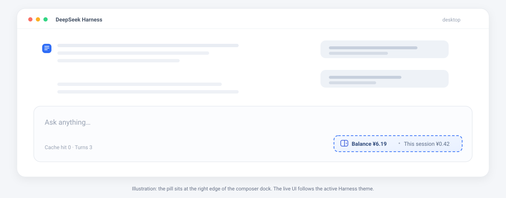

# Balance Pill

[](https://github.com/Jayve/dsh-balance-pill/actions/workflows/ci.yml)
[](https://www.npmjs.com/package/dsh-balance-pill)
[](LICENSE)

English | [简体中文](README.zh-CN.md)

A small, always-visible readout in the DeepSeek Harness composer dock: the
signed-in account's wallet balance and how much the wallet has dropped since
the current session started.



> Unofficial community plugin. Not affiliated with or endorsed by DeepSeek.

## Preview

A text sketch of the composer dock. The live pill follows the active theme and
locale.

```text
  ┌─ composer ──────────────────────────────────────────────────────
  │ Ask anything…
  │
  │ Cache hit 0 · Turns 3        (o) Balance ¥6.19 · This session ¥0.42
  └─────────────────────────────────────────────────────────────────

  [ready]      (o) Balance ¥6.19 · This session ¥0.42
  [loading]    (o) Balance …
  [signed out] (o) Balance —
  [error]      (o) Balance — (http-503)

  ┌─ hover ───────────────────────────────────────────────────────
  │ Recharged ¥6.19 · Granted ¥0.00 · Updated 12:34:56
  │ Counting since 12:30:02
  │ Click to refresh
  └───────────────────────────────────────────────────────────────
```

The pill is one tabbable button: click to refresh, hover for the breakdown and
the start time of the session total.

## What it shows

| Reading | Meaning |
| --- | --- |
| **Balance** | Recharged wallet plus granted/bonus wallet, folded into one currency. |
| **This session** | Sum of wallet decreases observed since this session's first reading. |

- Hover the pill for the recharge/granted breakdown, the last update time, and
  when counting started.
- Click the pill to refresh immediately.
- The pill also refreshes every 60 seconds, when the window regains focus, and
  shortly after each completed turn. Two automatic readings are at least 15
  seconds apart. Repeated failures back off at 120 s → 240 s → 300 s (capped).
- The last successful reading is reused for the first paint after a page
  reload, so the dock does not flash an empty value.

## Install

Requirements:

- DeepSeek Harness Desktop or Web, `0.2.1-rc.2` through `0.2.x`.
- A signed-in DeepSeek account (the plugin reads the same wallet the account
  menu shows).
- The `deepseekAccount` Host service. It ships with the desktop account stack;
  a headless composition without that service reports `account-unavailable`.

Pick one source.

### From npm

```sh
dsh plugin --profile web add dsh-balance-pill
```

Published as [`dsh-balance-pill`](https://www.npmjs.com/package/dsh-balance-pill)
by the `jayve-dev` npm account. The package is unscoped, so the install path is
just the package name.

### From GitHub

```sh
dsh plugin --profile web add github:Jayve/dsh-balance-pill
```

### From a checkout

```sh
git clone https://github.com/Jayve/dsh-balance-pill.git
dsh plugin --profile web add ./dsh-balance-pill
```

`web` is the profile name used by the CLI Web app. The desktop app usually uses
`desktop`; substitute it in every command:

```sh
dsh plugin --profile desktop add dsh-balance-pill
```

After installation, restart the Harness process (Host code changes need a
restart, not just a page reload), then reload the Web page. Verify that the
bundle layer is present:

```sh
dsh --profile web --dump-config
```

Look for a `# == dsh-balance-pill` layer and a `balance-pill` row. If the plugin
is listed but the pill is missing, see [Troubleshooting](#troubleshooting).

### Uninstall

```sh
dsh plugin --profile web remove dsh-balance-pill
```

### Migrating from a local build

If a development row such as `@local/dsh-balance-meter` is still active, remove
that bundle before adding this one. The two pills would otherwise render side
by side; the new row id is `balance-pill`, so no config row collides, but the
dock entry and polling would be duplicated.

## How it works

The plugin has two halves:

1. **Client** — mounts one entry into the `conversation.composer.dock` slot,
   polls a local JSON route, and keeps the per-session running total in
   `localStorage`.
2. **Host** — serves `GET /dsh-balance-pill/state` on the Harness Web server.
   It asks the Host account service for the current wallet and returns only the
   aggregated amounts.

The browser never calls the account Remote namespace and never sees a token,
an account id, or a Platform request header. This split exists because the
account Remote call that works on the Host can fail from the desktop renderer;
the local route is the stable path across Web and Desktop builds.

### Route

`GET /dsh-balance-pill/state?locale=<ui locale>&tz=<offset seconds>`

The route accepts only loopback peers, a loopback `Host` authority, and only
`GET`. Responses are `Cache-Control: no-store`.

| Status | Body | Meaning |
| --- | --- | --- |
| `200` | `{"ok":true,"status":"ready","currency":"CNY","recharged":6.19,"granted":0,"total":6.19}` | Wallet read succeeded. |
| `200` | `{"ok":true,"status":"signed-out"}` | No stored DeepSeek credential. |
| `200` | `{"ok":true,"status":"failed"}` | The Platform balance query failed. |
| `403` | `{"ok":false,"error":"loopback-only"}` | Non-loopback peer. |
| `403` | `{"ok":false,"error":"host-not-allowed"}` | `Host` is not `127.0.0.1`, `localhost`, or `[::1]`. |
| `405` | `{"ok":false,"error":"method-not-allowed"}` + `Allow: GET` | Wrong method. |
| `502` | `{"ok":false,"error":"…"}` | Unexpected account service failure (message capped at 200 characters). |
| `503` | `{"ok":false,"error":"account-unavailable"}` | Composition has no account service. |

The full route and ledger contract is in
[docs/architecture.md](docs/architecture.md).

## Spend accounting

The plugin measures the wallet, not tokens or prices, so it works with every
model and billing rule without a price table.

- A **decrease** between two readings adds to `This session`.
- A **top-up or bonus** only moves the baseline; it never produces negative
  spend.
- The baseline and running total are stored per session under
  `dsh.balance-pill/v1/<sessionId>`. A page reload keeps the number; a new
  session starts at zero.
- Switching the UI language or timezone does not reset the ledger.
- Switching **accounts** while the same session stays open reuses the previous
  account's baseline. Sign out and start a new session, or remove that
  session's `localStorage` entry, if you need a clean count.
- **Multiple sessions on one account** all observe the same wallet. Each
  session counts every other session's spend as its own. The plugin cannot
  attribute a wallet drop to a session.
- Platform billing can settle late; the reading lags by the same amount.
- Amounts below `0.01` are shown with four decimals so a small turn does not
  look free.
- An account holding both CNY and USD wallets gets one pill, preferring CNY.

## Privacy and security

- The route is bound to the Harness Web server and rejects non-loopback peers.
- The `Host` header must name a loopback authority (`127.0.0.1`, `localhost`,
  or `[::1]`). A public hostname that resolves to loopback is refused, which
  closes the DNS-rebinding path to this route.
- The route has **no additional authentication**, like the other local
  plugin routes. Any process on the same machine can read the balance number.
  The response contains only currency amounts; it carries no account id,
  profile, token, or transaction list.
- The Client stores only the last summary and the per-session ledger in
  `localStorage`, on the Harness origin. It contains no credentials.
- The plugin sends no telemetry. The only network request is the Host account
  service call to the configured DeepSeek Platform origin, the same one the
  account menu performs.
- The browser bundle adds no remote content and no `eval`.

## Configuration

The shipped patch enables the plugin with defaults. Most users need no config.

`clientVersion` is the UI identity sent to the Platform account endpoint. By
default the plugin reports the running Web host's release version and falls
back to the version this release was tested against. Pin it only when a
composition hides the `clientModules` service or you need to reproduce a
specific Platform client identity:

```yaml
- id: balance-pill
  name: dsh-balance-pill
  config:
    clientVersion: 0.2.1-rc.2
```

The refresh interval and the route path are fixed on purpose: they are
security- and traffic-shaping constants, not deployment knobs.

## Troubleshooting

| Symptom | Check |
| --- | --- |
| No pill at all | The bundle is not active. Run `dsh --profile web --dump-config`, confirm the `dsh-balance-pill` layer, then restart the Harness process and reload the page. |
| Pill shows `Balance —` | The account is signed out, or the credential store is empty. Sign in from the account menu. |
| Tooltip says `Balance read failed` | Hover for the short error code. `http-503` means the composition has no `deepseekAccount` service; `http-502` means the Platform query threw. |
| Number does not change | Billing may be delayed. Click the pill; a forced read still respects the in-flight guard. |
| Spend looks too high | Another session on the same account was spending, or the session was reused across accounts. The wallet cannot attribute spend. |
| `403 loopback-only` | The page was opened through a LAN address. Use `http://127.0.0.1:<port>/`. |
| `403 host-not-allowed` | The page was opened through a non-loopback hostname that resolves to this machine. Use `127.0.0.1`, `localhost`, or `[::1]`. |

## Compatibility

| Component | Supported |
| --- | --- |
| DeepSeek Harness | `>=0.2.1-rc.2 <0.3.0` (declared as `engines.dsh`) |
| Surfaces | Desktop Web GUI; CLI `web` profile |
| Account service | `deepseekAccount` (DeepSeek account login) |
| Node (development only) | `^22.19.0` or `>=24.0.0` |

The manifest declares `engines.dsh`, so an incompatible Harness release refuses
the bundle instead of loading it half-way. Removing that field is not a
supported workaround; open an issue with the Harness version instead.

## Development

The package has no runtime dependencies and no build step.

```sh
npm test          # node --test; Host route, ledger, formatting, loader contract
npm run pack:check
```

Layout:

```text
index.js              Host route and wallet folding
client.js             Client bundle (dock entry, polling, ledger)
test/host.test.mjs    Route and summary tests
test/client.test.mjs  Ledger, storage, and formatting tests
docs/                 Preview and architecture notes
```

To iterate against a real Harness install, add the checkout to the profile you
use for the Web GUI (use a disposable profile when you do not want to disturb a
daily setup), from the repository root:

```sh
dsh plugin --profile web add .
dsh web --profile web
```

Host edits require restarting the process. Client bundle edits require a page
reload.

`_internals` on the client module is a test bridge, not public API. It exists
so the ledger can be tested without a browser or React renderer.

## Releasing

1. Update `CHANGELOG.md` and the version in `package.json`.
2. `npm test && npm run pack:check`.
3. Commit, tag `vX.Y.Z`, and publish:
   - `npm publish --access public` from the `jayve-dev` npm account
   - or push the tag and let `.github/workflows/release.yml` publish with the
     repository's `NPM_TOKEN` secret (a token from the same account).

## License

[MIT](LICENSE) © 2026 Jayve
