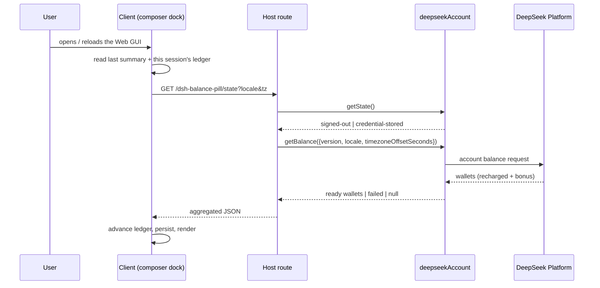

# Architecture

This note describes the contract behind Balance Pill: the Host route, the Client
ledger, and the boundaries that keep credentials out of the renderer.

## Process split



The Client never calls `remote.account.*`. The Host owns the account service
call, the Platform request headers, and the credential store. The browser
receives four numbers and two flags.

## Host contract

Module: [`index.js`](../index.js)

Exports:

| Export | Purpose |
| --- | --- |
| `name` | `balance-pill`, used by Loader diagnostics. |
| `inject` | `['webServer']`; the route cannot be registered earlier. |
| `ROUTE` | `/dsh-balance-pill/state`. |
| `FALLBACK_CLIENT_VERSION` | Last-resort Platform client identity. |
| `isLoopback(address)` | Exact loopback predicate used by the route. |
| `summariseBalance(balance)` | Wallet arrays → one currency summary. |
| `createStateHandler(ctx, config)` | Request handler without Cordis boot. |
| `apply(ctx, config)` | Registers the route as a `ctx.effect`. |

### Request

```
GET /dsh-balance-pill/state?locale=zh&tz=28800
```

- `locale`: UI language. The Host truncates it to 35 characters; the Platform
  reduces it to a wire locale.
- `tz`: whole seconds east of UTC. Non-numeric values become `0`.
- The `Host` header must name `127.0.0.1`, `localhost`, or `[::1]` (a port is
  allowed). Any other authority → `403 host-not-allowed`. This blocks a
  rebinding page served from a public name that resolves to loopback.
- Any other method → `405` with `Allow: GET`.
- `req.socket.remoteAddress` must be `127.0.0.1`, `::1`, or
  `::ffff:127.0.0.1`; otherwise `403 loopback-only`.

### Response

All bodies are JSON with `Cache-Control: no-store`,
`X-Content-Type-Options: nosniff`, and `Referrer-Policy: no-referrer`.

| Status | Body | Trigger |
| --- | --- | --- |
| `200` | `{ ok: true, status: 'ready', currency, recharged, granted, total }` | `getState()` says `credential-stored` and `getBalance()` returns a ready balance with at least one parsable wallet. |
| `200` | `{ ok: true, status: 'signed-out' }` | `getState()` is not `credential-stored`, or `getBalance()` returns `null`. |
| `200` | `{ ok: true, status: 'failed' }` | `getBalance()` reports `status: 'failed'`, or no wallet survives `summariseBalance`. |
| `403` | `{ ok: false, error: 'loopback-only' }` | Non-loopback peer. |
| `403` | `{ ok: false, error: 'host-not-allowed' }` | `Host` is not a loopback authority. |
| `405` | `{ ok: false, error: 'method-not-allowed' }` | Method other than `GET`. |
| `502` | `{ ok: false, error: <message ≤ 200 chars> }` | Account service threw. |
| `503` | `{ ok: false, error: 'account-unavailable' }` | Composition has no `deepseekAccount` service. |

`summariseBalance` folds `balance.value` (recharged) and
`balance.bonusWallets` (granted) into a `Map` keyed by `CNY` or `USD`. Unknown
currencies, malformed wallets, and unparsable decimal strings are ignored. When
both currencies exist, CNY wins; the pill shows one currency at a time.

### Client identity

`getBalance` requires `{ version, locale, timezoneOffsetSeconds }`.

1. `config.clientVersion`, when a non-empty string, wins.
2. Otherwise the Host reads
   `ctx.get('clientModules')?.graph()?.release?.version`. This is the running
   Web host's release and is the identity the Platform expects.
3. If the optional registry is absent or its graph is not composed yet, the
   handler returns `FALLBACK_CLIENT_VERSION` without caching it, so a later
   request can still detect the release.

## Client contract

Module: [`client.js`](../client.js), loaded through
`window.__ModuleLoader__.load`.

- Package id: `dsh-balance-pill`.
- Cordis injections: `slots`, `locale`.
- Slot: `conversation.composer.dock`, entry id `balance-pill`, order `2`,
  locale namespace `dsh-balance-pill`.
- The bundle adds one `<style data-dsh-plugin="dsh-balance-pill">` element and
  removes it on dispose.

### Ledger

Two `localStorage` records, both on the Harness origin:

```jsonc
// dsh.balance-pill/last/v1
{ "currency": "CNY", "recharged": 6.19, "granted": 0, "total": 6.19, "at": 1760000000000 }

// dsh.balance-pill/v1/<sessionId>
{ "currency": "CNY", "lastTotal": 5.77, "spend": 0.42, "since": 1760000000000 }
```

`advanceProgress(previous, summary, now)`:

- No previous record, or a different currency → new baseline, `spend: 0`.
- `previous.lastTotal - summary.total > 0` → add the difference.
- Otherwise (top-up, unchanged balance) → keep spend, move `lastTotal`.
- `spend` is clamped to `>= 0` when read back.

The last summary is global so the first paint after a reload is never blank;
the ledger is per session so the session total starts at zero. `revision`
increments after every successful read and re-reads the ledger for the current
session.

### Refresh

| Trigger | Force? | Notes |
| --- | --- | --- |
| Mount | yes | Establishes the baseline. |
| Every 60 s | yes | One timer per mount. |
| Window focus / visible | no | Skipped within 15 s of the last request. |
| `sessionStats.steps` change + 2.5 s | no | The turn has usually settled by then. |
| Session switch | no | Re-reads the new session's ledger even when the fetch is rate-limited. |
| Click | yes | Still blocked by the in-flight guard. |

Failure backoff: `min(60_000 * 2^min(failures, 3), 300_000)` — 120 s, 240 s,
300 s, then 300 s. Any success resets the failure count. Each request carries a
20-second abort timer; an abort renders as the `timeout` code and releases the
in-flight guard in `finally`.

### Failure rendering

- With a previous ready summary, the pill keeps the last amounts and adds a
  short error code to the tooltip.
- Without one, it renders `Balance — (code)`.
- `signed-out` clears the last-summary cache and renders `Balance —` with the
  sign-in hint.

Error codes are the Host's `error` field when present (truncated to 24
characters by `shortCode`), otherwise `http-<status>`, `rejected`, `empty`, or a
network error message.

## Security boundaries

- **Credentials** never leave the Host. The route response has no account id,
  profile, token, or transaction list.
- **Network origin** is the loopback interface, and the request authority must
  name loopback. The route adds no CORS header, so a cross-origin page cannot
  read it even if it can reach the port; the authority check also refuses a
  public hostname that resolves to 127.0.0.1 (DNS rebinding).
- **Local processes** are not authenticated. This is the same trust model as
  other local plugin routes and is documented in the README.
- **Renderer content** is static: locale dictionaries and an inline SVG. No
  remote script, no `eval`, no `innerHTML`.
- **Storage** holds amounts only. A compromised Harness origin could read them,
  which is equivalent to reading the account balance from the UI.

## Testing

`node --test` runs two suites with no dependencies and no browser:

- `test/host.test.mjs` imports the Host module and drives
  `createStateHandler` with a request/response double. It covers loopback,
  authority, methods, account states, wallet folding, client identity, and
  error bounds.
- `test/client.test.mjs` evaluates `client.js` with a fake
  `window.__ModuleLoader__` and a React stub, then tests the exported
  `_internals`: summary normalisation, ledger advancement, storage recovery,
  formatting, and translation. No React renderer is involved.

`_internals` is a test bridge, not public API; the Harness client loader ignores
unknown exports.

## Non-goals

- Attributing spend to a specific session or account when several share one
  wallet.
- Replacing the account menu, billing pages, or usage statistics.
- Supporting non-DeepSeek providers: the balance comes from
  `deepseekAccount`.
- Making the route remotely reachable or adding a second authentication
  scheme.

## Known limitations

- The account service is Host-only; a composition without it has no balance.
- The Platform can settle late, so the ledger can lag the actual spend.
- Switching accounts inside one session reuses the old baseline until the
  session's ledger is cleared.
- The route is loopback-only by design; LAN and remote Web access show a 403.
